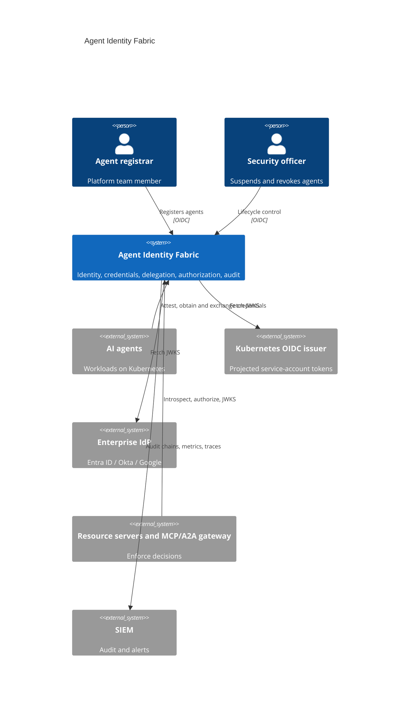
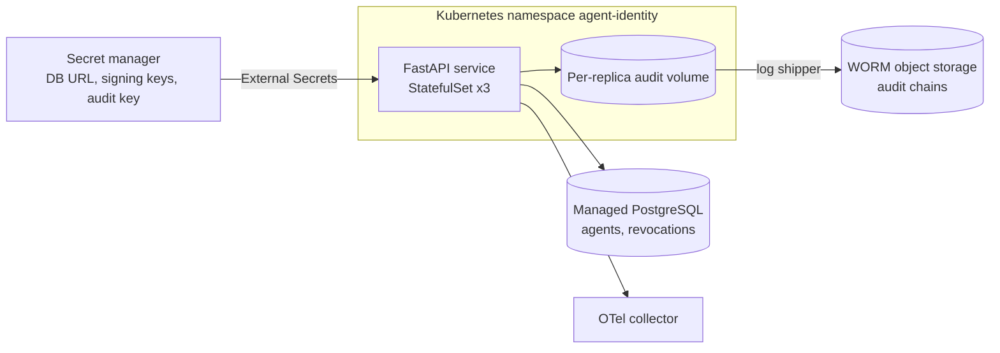
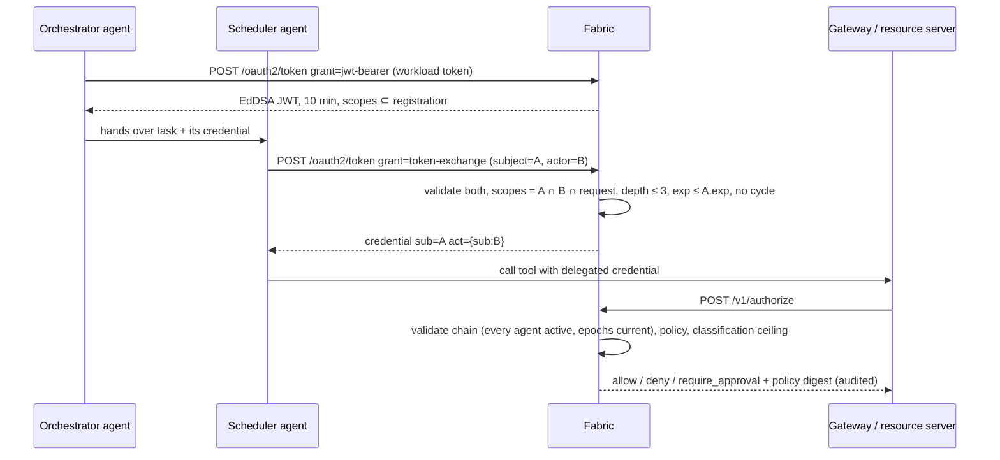
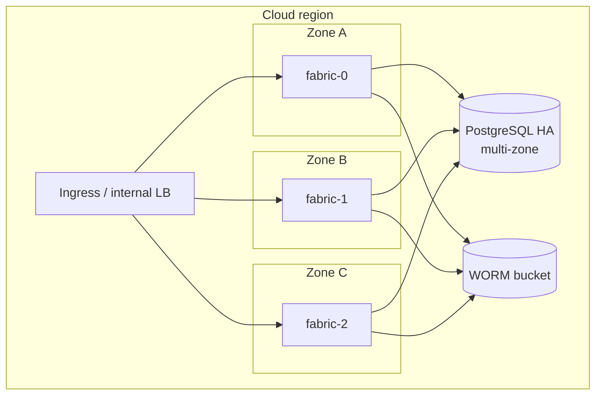

# Architecture

## System context (C4 level 1)



## Containers (C4 level 2)



## Components (C4 level 3)

| Layer | Module | Responsibility |
|---|---|---|
| API | `api.routes`, `api.app` | HTTP contract, OAuth wire formats, admin authentication, correlation IDs, metrics |
| Application | `application.service.IdentityFabric` | Use cases: register, attest, issue, exchange, validate, introspect, revoke, authorize; audit every outcome |
| Domain | `domain.models` | Agent aggregate and lifecycle state machine, delegation chain, credential claims |
| Security | `security.tokens`, `keys`, `attestation`, `jwks`, `admin` | Signing and verification, key ring, workload attestation, remote JWKS caching, admin OIDC |
| Infrastructure | `infrastructure.database` | SQLAlchemy Core repositories (PostgreSQL in production) |
| Runtime | `runtime.container` | Composition root; builds everything from settings |

## Sequences

### Registration and attestation

```mermaid
sequenceDiagram
  participant R as Registrar
  participant F as Fabric
  participant W as Agent workload
  participant K as Cluster OIDC issuer
  R->>F: POST /v1/agents (mandate, scopes, workload binding) + OIDC token
  F->>F: verify role agent-registrar; issuer trusted?
  F-->>R: 201 status=pending (audited)
  W->>F: POST /v1/attest (projected SA token)
  F->>K: GET JWKS (cached)
  F->>F: verify signature, iss, aud, sub == binding, image digest allowed
  F-->>W: status=active (audited)
```

### Credential issuance and delegation



### Suspension

Suspension increments the agent's credential epoch. Every token carries the
epoch it was issued under, so all outstanding credentials fail validation
immediately, including delegated tokens where the suspended agent appears
anywhere in the chain. No token list needs to be enumerated.

## Deployment view



Replicas are spread across zones (topology spread constraints); the PDB keeps
two available during voluntary disruption; PostgreSQL runs zone-redundant.

## Data

| Store | Data | Classification | Retention |
|---|---|---|---|
| PostgreSQL `agents` | Registration, mandate, lifecycle state | INTERNAL | Life of agent + 7 years (records) |
| PostgreSQL `revoked_tokens` | Token IDs and expiry | INTERNAL | Until token expiry (purged every 15 min) |
| Audit chains | Who did what, under which policy | CONFIDENTIAL | 7 years, WORM |
| Signing keys | Ed25519 private keys | SECRET | Rotated every 90 days |

Credentials and workload tokens are never persisted or logged.
